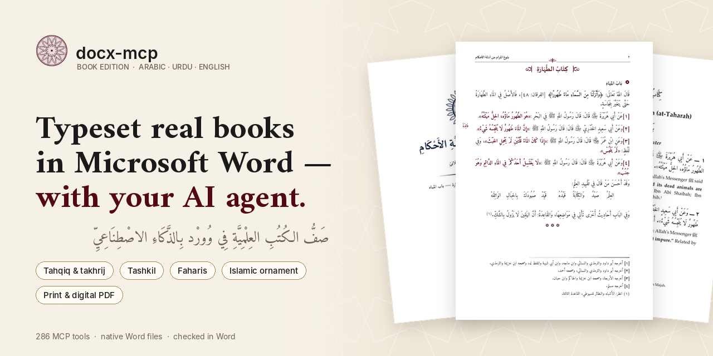
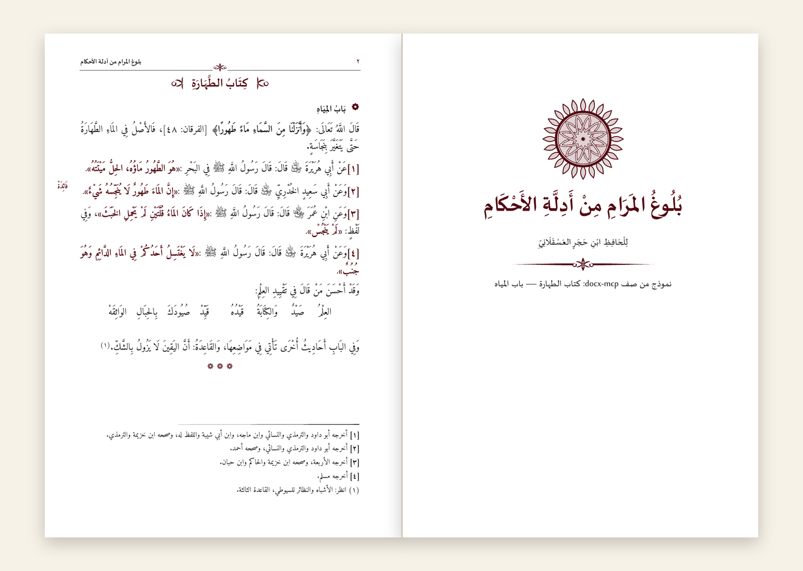
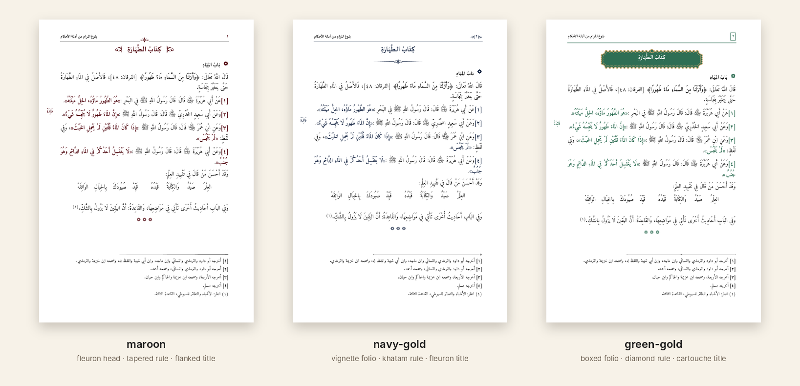
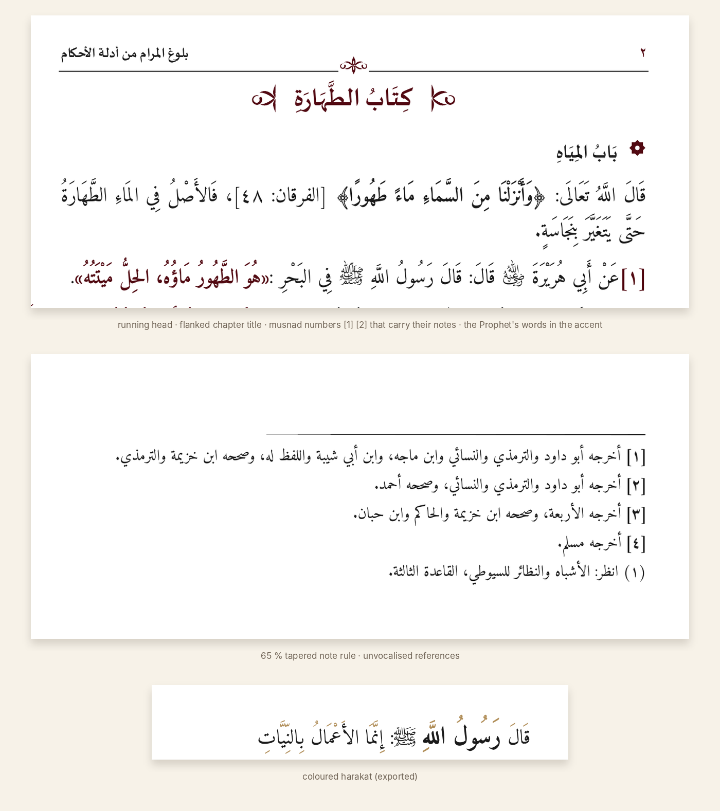
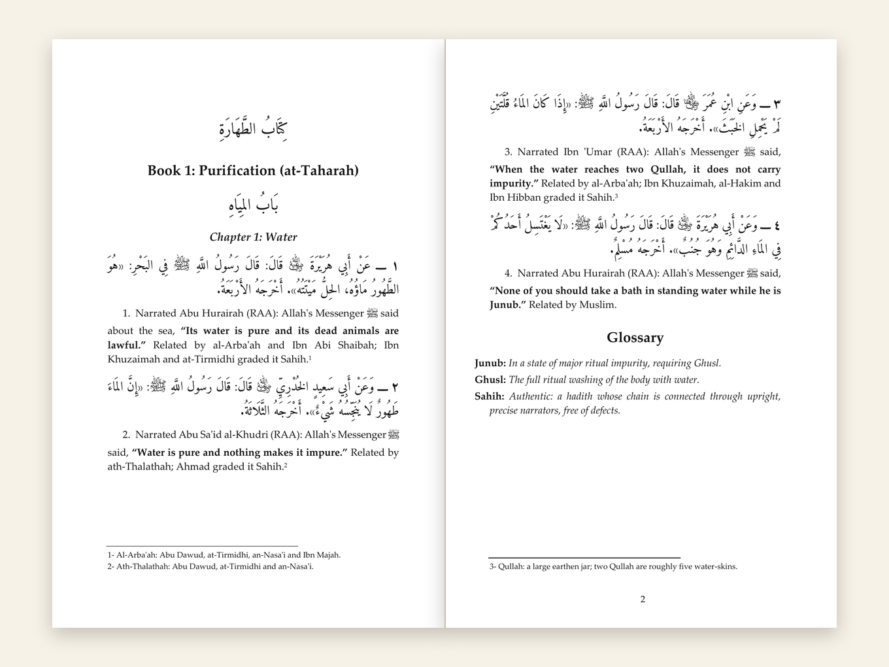
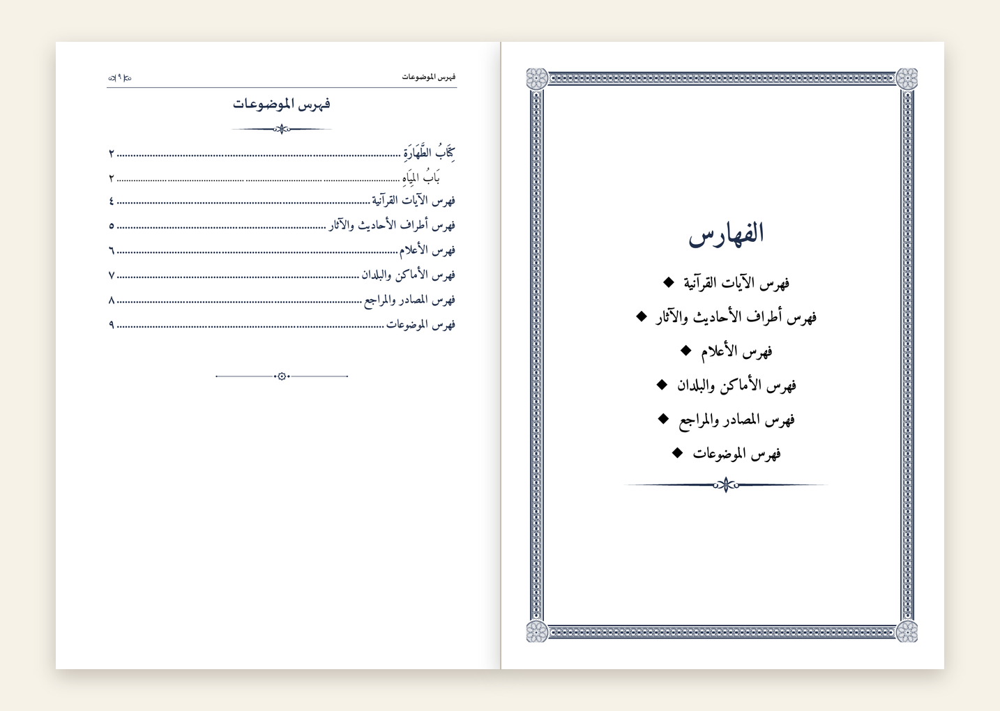
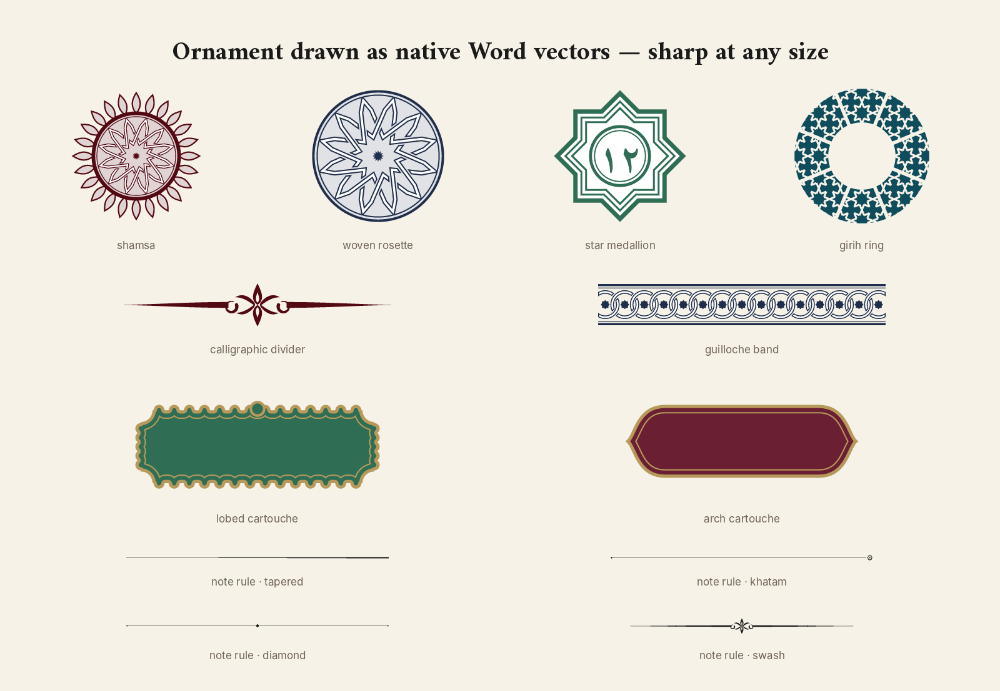
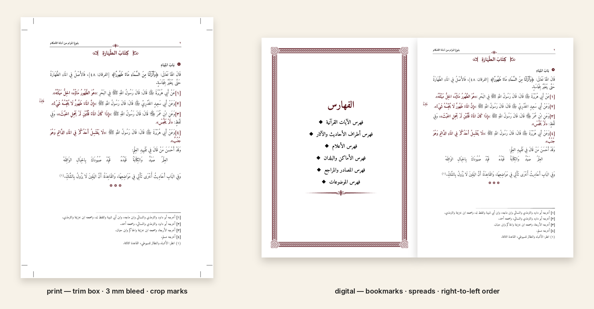

<p align="center">
  
</p>

<h1 align="center">docx-mcp · Book Edition</h1>

<p align="center">
  <b>The MCP server that typesets real books in Microsoft Word.</b><br>
  Arabic tahqiq editions, Urdu Nastaliq, English and bilingual hadith books —<br>
  with tashkil, footnotes, faharis, Islamic ornament and print-ready PDFs.
</p>

<p align="center" dir="rtl">
  صفُّ الكتب العلمية في «وورد» بالذكاء الاصطناعي: تحقيق وتخريج، تشكيل، حواشٍ، فهارس، زخارف إسلامية، وملفات PDF جاهزة للطباعة.
</p>

<p align="center">
  <a href="#install"></a>
  
  
  
  
  
  <a href="LICENSE"></a>
</p>

<p align="center">
  <a href="#what-it-makes">Gallery</a> ·
  <a href="#ask-your-agent">Prompts</a> ·
  <a href="#features">Features</a> ·
  <a href="#install">Install</a> ·
  <a href="docs/BOOKS.md">Book guide</a> ·
  <a href="CHANGELOG.md">Changelog</a>
</p>

---

Scholarly books are hard to typeset. Arabic needs right-to-left layout that
holds when Latin words appear. Vocalised text needs room for its harakat.
Footnotes need «(١)» marks, a designed rule and «=» where a note runs on.
Hadith need musnad numbers that carry their takhrij. A book needs running
heads, faharis with live page numbers and art a printer can use. Word can do
all of it, but nobody has time to click it together for every client.

**docx-mcp Book Edition hands that work to your AI agent.** Ask Claude (or any
MCP client) for a book and it builds it as a real Word file: proper styles,
live footnotes, live indexes, vector ornament. You can still open it and edit
it like any document. Then it exports the PDF your printer or your readers
need.

It is a fork of [SecurityRonin/docx-mcp](https://github.com/SecurityRonin/docx-mcp).
Everything the original does (tracked changes, comments, contract review)
still works, and Word-compatibility fixes are made here as well.

## What it makes

Every image below is a page **rendered by Microsoft Word** from a file this
server wrote. Nothing is mocked up.

<p align="center">
  
</p>

**One book, any house.** Colours, running heads, note rules and heading
designs are switchable per client. The text never changes:

<p align="center">
  
</p>

**The details printers look for:** running heads with the chapter on odd pages
and the title on even ones, «[١]» narration numbers that open their own
footnote, the Prophet's words ﷺ in the accent colour, a 65% note rule,
unvocalised references and coloured harakat:

<p align="center">
  
</p>

**English and bilingual books,** set like the English *Bulugh al-Maram*: the Arabic
text, then «1. Narrated …» with the Prophet's words in bold, the source line,
and a glossary.

<p align="center">
  
</p>

**Faharis, built for you:** verses, hadith openings (atraf), people, places,
sources and topics. Each is a live Word index with page numbers, behind a framed
part-title page.

<p align="center">
  
</p>

**Ornament drawn with real constructions** (Hankin girih, woven strapwork,
Bézier fleurons) and inserted as native Word vectors:

<p align="center">
  
</p>

**Print and screen from one file.** The print PDF has a trim box, 3 mm bleed
and crop marks. The digital PDF has bookmarks, book spreads and right-to-left
page order:

<p align="center">
  
</p>

## Ask your agent

> *"Typeset this risalah as a tahqiq book: 17×24, maroon. Number the narrations
> [١], [٢]… and move each takhrij into its number's footnote. Colour only the
> Prophet's words, end each section with ❁ ❁ ❁, and add the faharis."*

> *"Same book for a different client: navy and gold, vignette page numbers,
> cartouche chapter titles. Then give me a print PDF with 5 mm bleed."*

> *"Make an English edition of Bulugh al-Maram's chapter on water: Arabic,
> then the translation with the Prophet's words in bold, a source line and a
> glossary."*

> *"Check the manuscript's tashkil, strip the harakat from the references in the
> footnotes, and colour the vowels gold in the PDF."*

> *"Set this Urdu book in Jameel Noori Nastaleeq with chapters on new pages
> and honorifics as real glyphs."*

## Features

| | |
|---|---|
| **Whole book in one call** | `apply_book_preset("tahqiq" \| "kitab" \| "urdu-nastaliq" \| "english" \| "bilingual")` sets page size, fonts, a labelled style set, running heads, folio, footnote design, note marks, tashkil handling, honorifics and colours |
| **House colours** | `set_house_colors`: maroon, brick, navy-gold, green-gold, teal, burgundy-silk, ink, or the client's own. Every design tool follows them, and colour marks structure, never reading text |
| **Headings** | `insert_heading` designs: plain, fleuron, flanked (calligraphic brackets measured to the title), cartouche, bullet. The art never leaks into the table of contents |
| **Tashkil** | Safe line spacing for vocalised text. Notes, references and book names stay unvocalised. `tashkil_report`, `tashkil` (normalize, strip, keep-shadda, light), `color_tashkil`. Searches ignore harakat |
| **Footnotes** | «(١)» or «57-» marks, a rule over 65% of the line (plain, tapered, khatam, diamond, swash), «=» continuation, musnad numbers that carry their own note |
| **Running heads** | Chapter on odd pages, title on even, folio on the outer side: fleuron, rule, boxed, vignette or cartouche |
| **Faharis** | `build_faharis`: Qur'an, atraf, people, places, sources and topics, all live Word indexes |
| **Hadith & poetry** | Musnad numbering, `insert_verses` for couplets, `define_numbered_style` for self-numbering tarajim, margin side-heads |
| **English books** | `insert_hadith_entry`, `insert_bilingual_heading`, `insert_glossary_entry` |
| **Honorifics** | ﷺ ﵁ ﵂ ﵃ … as real glyphs (Scheherazade New or Jameel Noori artwork), coloured |
| **Ornament** | Shamsa, rosettes, star medallions, girih rings, dividers, bands, cartouches, woven page frames, or your own SVG |
| **Right-to-left done right** | Arabic and Urdu are detected and marked RTL on save, mixed lines included. Kashida justification uses the setting Word can draw |
| **PDF** | `export_pdf("print" \| "digital")` through Microsoft Word (or LibreOffice), with bleed, crop marks, trim box, bookmarks, spreads and PDF/A. A client's wishes are saved with `set_pdf_preferences` |
| **Word-safe output** | Every file is validated against the ECMA-376 schemas and checked in Microsoft Word |

The [book guide](docs/BOOKS.md) covers every tool and option.

## Install

**Claude Code**

```bash
claude mcp add docx-mcp -- uvx --from "docx-mcp-server @ git+https://github.com/AbubakarYasir/docx-mcp@main" docx-mcp-server
```

**Claude Desktop, Cursor, Windsurf, VS Code**: add to the MCP settings:

```json
{
  "mcpServers": {
    "docx-mcp": {
      "command": "uvx",
      "args": ["--from", "docx-mcp-server @ git+https://github.com/AbubakarYasir/docx-mcp@main", "docx-mcp-server"]
    }
  }
}
```

The server installs its companion skill on first start
(`~/.claude/skills/docx-mcp/SKILL.md`). The skill teaches the agent the book
workflow, the design rules and the OOXML pitfalls.

**For the best results**

- **Microsoft Word on Windows** for PDF export. Fields, indexes and contents
  are refreshed and laid out by Word itself. LibreOffice is used elsewhere.
- **Fonts:** Amiri, Sakkal Majalla (ships with Windows), Scheherazade New for
  honorifics, and Jameel Noori Nastaleeq for Urdu.
- Python 3.10+ on Windows, macOS or Linux.

## Quick start

```text
create_document("risalah.docx")
apply_book_preset("tahqiq", title="بلوغ المرام", author="ابن حجر", palette="maroon")
insert_heading("كِتَابُ الطَّهَارَةِ", level=1, design="flanked")
insert_paragraph(after, "عَنْ أَبِي هُرَيْرَةَ … «هُوَ الطَّهُورُ مَاؤُهُ، الحِلُّ مَيْتَتُهُ».")
add_custom_mark_note(para, "أخرجه أبو داود والترمذي …", mark="[١]", where="start")
format_matches("«[^»]+»", regex=True, char_style="Prophetic Speech")
insert_separator(after)
apply_honorifics()
build_faharis(people=["أبو هريرة"], sources=["سنن أبي داود"])
save_document()
export_pdf("risalah-print.pdf", "print")
export_pdf("risalah.pdf", "digital")
```

## Tested in Word, not just in theory

Every feature was rendered in Microsoft Word 365 and looked at page by page.
That found Word behaviours you won't find in the documentation, and the
server now handles them:

- Medium and high **kashida** make Word drop whole lines of vocalised Arabic.
  "Kashida" here means low kashida, which is safe.
- Word draws automatic numbers (note marks, page numbers) with the
  **computer's** numeral setting. The export sets ١٢٣ for Arabic books and 123
  for English ones, then restores the user's choice.
- Word colours **diacritics** with one colour for the whole document, not
  run by run. `color_tashkil` stores the colour and the export applies it.
- Word drops the space above a paragraph at the **top of a page**. Heading
  art is anchored to the text line, so it never drifts off its title.
- A run holding only harakat must stay right-to-left, or Word breaks the word
  into separate letters.

1,382 automated tests run on every change, and a guard test makes sure every
design method is a server tool with the same defaults.

## Also in the box: the document engine

Everything from upstream docx-mcp: tracked changes, comments, contract review,
change logs, markdown to Word, tables, PII scrubbing and more.

### What the engine does

| Capability | What your agent can do |
|---|---|
| **Create documents** | Start blank, from a `.dotx` template, or from markdown — headings, tables, lists, images, footnotes, code blocks, smart typography |
| **Track changes** | Insert, delete, and replace text as tracked revisions — underlined insertions, red strikethrough deletions. Pass `tracked=False` to any editing tool to write the change directly with no revision markup. Accept or reject changes by author. |
| **Change log** | After editing with tracked changes, call `generate_change_summary` for a numbered .txt listing every insertion, deletion, and replacement. Or use `diff_to_text` to compare two separate files and get the same output automatically — useful for document versions you didn't edit yourself. |
| **Comments** | Add comments anchored to specific paragraphs, reply to comment threads |
| **Find and replace** | Search by text or regex across body, footnotes, and comments — then make targeted edits |
| **Tables** | Create tables, modify cells, add or delete rows — all with revision tracking |
| **Footnotes & endnotes** | Add, list, and validate cross-references |
| **Formatting** | Bold, italic, underline, color — with revision tracking so formatting changes are visible |
| **Headers & footers** | Read and edit header/footer content with tracked changes |
| **Images** | List embedded images, insert new ones with specified dimensions |
| **Sections & layout** | Page breaks, section breaks, page size, orientation, margins |
| **Cross-references** | Internal hyperlinks between paragraphs with bookmarks |
| **Document merge** | Combine content from multiple DOCX files |
| **Protection** | Lock documents for tracked-changes-only, read-only, or comments-only with passwords |
| **Structural audit** | Validate footnotes, headings, bookmarks, images, and internal consistency before delivery |
| **Watermark removal** | Detect and strip DRAFT watermarks from headers |
| **PII scrubbing** *(experimental)* | Detect names, emails, phone numbers, SSNs, and more using Presidio + spaCy NER. Produces true XML redaction — original text permanently deleted, replaced with a solid black rectangle. **Not for production use** — see [limitations](#pii-scrubbing-experimental). |


### Example: Contract Review with Redlines

```
1. open_document("services-agreement.docx")
2. get_headings()                              → see document structure
3. search_text("30 days")                      → find the payment clause
4. delete_text(para_id, "30 days")             → tracked deletion  (red strikethrough)
5. insert_text(para_id, "60 days")             → tracked insertion (green underline)
6. add_comment(para_id, "Extended per client request — see Amendment 3")
7. audit_document()                            → verify structural integrity
8. save_document("services-agreement_redlined.docx")
```

Open the output in Word and you see exactly what a human reviewer would produce — revision marks, comments in the margin, clean document structure.

### Example: Change Log After a Revision Session

```
1. open_document("contract.docx")
2. replace_text(para_id, "30 days", "60 days")           → tracked revision (del + ins)
3. add_comment(para_id, "Extended per Amendment 3")
4. save_document("contract_redlined.docx")
5. generate_change_summary("contract_changes.txt")
```

The `.txt` output reads like:

```
1. REPLACEMENT by Claude on 2026-05-25
   Deleted:  "30 days"
   Inserted: "60 days"
```

Paste it into an email, a PR description, or a handover note.

### Example: Compare Two Separate Document Versions

No editing session required — point it at any two files:

```
1. diff_to_text("proposal_v1.docx", "proposal_v2.docx")
```

Returns two files:
- `proposal_v1_diff.docx` — open in Word to see tracked changes inline
- `proposal_v1_diff.txt` — plain-text summary, ready to paste anywhere

### Example: Pentest Report from Markdown

```
1. create_from_markdown("pentest-report.docx",
       md_path="findings.md",
       template_path="client-template.dotx")
2. audit_document()                            → verify integrity
3. save_document()                             → ready for delivery
```

Your markdown findings — headings, tables of affected hosts, code blocks with proof-of-concept output, severity ratings — become a formatted Word document matching the client's template. Smart typography is applied automatically (curly quotes, em dashes, proper ellipses).

### PII Scrubbing (Experimental)

> **This feature is experimental and NOT suitable for production use or as the sole control for privileged, regulated, or legally sensitive documents.**

`scrub_pii` uses Microsoft Presidio with a spaCy NER model (`en_core_web_lg`, ~560 MB, downloaded on first call) to detect and permanently redact personal information. Redacted spans are replaced with solid black DrawingML rectangles — the original text is deleted from the XML, not merely hidden.

**What it detects reliably** (via regex/pattern matching, high confidence):
- Email addresses, phone numbers, credit card numbers, SSNs, IBANs, IP addresses, US passport numbers

**What it detects statistically** (via NER, will have misses):
- Person names, organisation names, locations, dates

**Known NER gaps — these will be missed:**
- Names in ALL-CAPS (common in ledgers, table headers, legal party designations)
- Single-token names with no surrounding context
- Non-English names (Arabic, CJK, African name patterns have low recall on this English model)
- Names embedded in legal boilerplate (`Lender: Jane Doe`, `Authorized Signatory: John Smith`)

**Recommended workflow:**

```
1. open_document("sensitive.docx")
2. scrub_pii(dry_run=True)             → review detected entities — check for misses
3. scrub_pii("sensitive_redacted.docx") → produce redacted copy
4. open the output in Word and verify manually before sharing
```

Always treat the output as a first pass requiring human review, not a finished redaction.

### How It Works

A `.docx` file is a ZIP archive of XML files. This server unpacks the archive, edits the XML directly, and repacks it. This is what gives it the ability to produce real tracked changes, comments, and footnotes — things that higher-level document libraries can't do.

Every edit is validated against the OOXML specification before saving, catching issues like orphaned footnotes, duplicate internal IDs, and broken cross-references that would otherwise cause Word to "repair" (and silently rewrite) your document.

<details>
<summary>Full tool inventory (200+ tools)</summary>

### Document Lifecycle

| Tool | Description |
|---|---|
| `open_document` | Open a .docx file for reading and editing |
| `create_document` | Create a new blank .docx (or from a .dotx template) |
| `create_from_markdown` | Create a .docx from GitHub-Flavored Markdown |
| `close_document` | Close the current document and clean up |
| `get_document_info` | Get overview stats (paragraphs, headings, footnotes, comments) |
| `save_document` | Save changes back to .docx (can overwrite or save to new path) |

### Reading

| Tool | Description |
|---|---|
| `get_headings` | Get heading structure with levels and text |
| `search_text` | Search across body, footnotes, and comments (text or regex) |
| `get_paragraph` | Get full text and style of a paragraph |

### Track Changes

| Tool | Description |
|---|---|
| `insert_text` | Insert text as tracked revision (underlined in Word) — or directly with `tracked=False` |
| `delete_text` | Mark text deleted (red strikethrough in Word) — or remove directly with `tracked=False` |
| `replace_text` | Replace text as a tracked del+ins pair — or directly with `tracked=False` |
| `modify_cell` | Modify a table cell — tracked by default, `tracked=False` for direct writes |
| `edit_header_footer` | Edit header/footer text — tracked by default, `tracked=False` for direct writes |
| `set_formatting` | Apply bold/italic/underline/color with tracked-change markup |
| `set_track_changes` | Enable or disable Word's built-in track-changes recording flag |
| `get_tracked_changes` | List all pending tracked changes (author, date, type, text) |
| `accept_changes` | Accept tracked changes, optionally filtered by author |
| `reject_changes` | Reject tracked changes, optionally filtered by author |

### Change Log

| Tool | Description |
|---|---|
| `generate_change_summary` | Export all tracked changes in the open document as a numbered .txt file — insertions, deletions, and adjacent del+ins pairs grouped as replacements |
| `compare_documents` | Diff two DOCX files and produce a tracked-change DOCX (Word-openable) |
| `diff_to_text` | Diff two DOCX files and produce both a tracked-change DOCX and a plain-text summary .txt |

### Tables

| Tool | Description |
|---|---|
| `get_tables` | Get all tables with row/column counts and cell content |
| `add_table` | Insert a new table after a paragraph |
| `modify_cell` | Modify a table cell with tracked changes |
| `add_table_row` | Add a row to a table |
| `delete_table_row` | Delete a table row with tracked changes |

### Lists

| Tool | Description |
|---|---|
| `add_list` | Apply bullet or numbered list formatting to paragraphs |

### Comments

| Tool | Description |
|---|---|
| `get_comments` | List all comments with ID, author, date, and text |
| `add_comment` | Add a comment anchored to a paragraph |
| `reply_to_comment` | Reply to an existing comment (threaded) |

### Footnotes & Endnotes

| Tool | Description |
|---|---|
| `get_footnotes` | List all footnotes with ID and text |
| `add_footnote` | Add a footnote with superscript reference |
| `validate_footnotes` | Validate footnote cross-references |
| `get_endnotes` | List all endnotes with ID and text |
| `add_endnote` | Add an endnote with superscript reference |
| `validate_endnotes` | Validate endnote cross-references |

### Headers, Footers & Styles

| Tool | Description |
|---|---|
| `get_headers_footers` | Get all headers and footers with text content |
| `edit_header_footer` | Edit header/footer text with tracked changes |
| `get_styles` | Get all defined styles |

### Properties & Images

| Tool | Description |
|---|---|
| `get_properties` | Get core document properties (title, creator, dates) |
| `set_properties` | Set core document properties |
| `get_images` | Get all embedded images with dimensions |
| `insert_image` | Insert an image after a paragraph |

### Sections & Cross-References

| Tool | Description |
|---|---|
| `add_page_break` | Insert a page break after a paragraph |
| `add_section_break` | Add a section break (nextPage, continuous, evenPage, oddPage) |
| `set_section_properties` | Set page size, orientation, and margins |
| `add_cross_reference` | Add a cross-reference link between paragraphs |

### Protection & Merge

| Tool | Description |
|---|---|
| `set_document_protection` | Set document protection with optional password |
| `merge_documents` | Merge content from another DOCX |

### Validation & Audit

| Tool | Description |
|---|---|
| `validate_paraids` | Check internal ID uniqueness across all document parts |
| `remove_watermark` | Remove VML watermarks from document headers |
| `audit_document` | Comprehensive structural audit |

</details>


## Documentation

- **[Book guide](docs/BOOKS.md)**: every book tool, with options and recipes
- **[Companion skill](docx_mcp/skill/SKILL.md)**: what the agent learns
- **[FORK.md](FORK.md)**: what this fork changes and how it is checked
- **[CHANGELOG.md](CHANGELOG.md)**: every change, with the reason for it

## Credits

Built on [docx-mcp](https://github.com/SecurityRonin/docx-mcp) by Security
Ronin (MIT). The Book Edition is maintained by
[Abu Bakar Gondal](https://github.com/AbubakarYasir). The design rules were
studied from printed tahqiq editions and English hadith collections. Fonts
belong to their authors: Amiri and Scheherazade New are under the SIL Open
Font License.

Released under the [MIT License](LICENSE).
